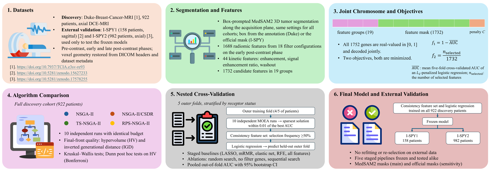

<div align="center">

# TRIAD

**Multi-objective evolutionary feature selection for a compact, kinetics-enriched breast MRI model of hormone receptor status**

[](https://www.python.org/)
[](https://pymoo.org/)
[](LICENSE)

[Overview](#overview) •
[Results](#main-results) •
[Installation](#installation) •
[Data](#data) •
[Reproducing the paper](#reproducing-the-paper) •
[Repository layout](#repository-layout) •
[Citation](#citation)

</div>

---

## Overview

Radiomics pipelines usually fix the image filters, then select features, then tune the classifier, so model size is never optimized. **TRIAD** encodes all three decisions in one real-valued chromosome and lets a multi-objective evolutionary algorithm trade discrimination against the number of features:

```
chromosome = [ 19 feature-group genes | 1732 feature genes | 1 regularization gene ]
                 18 image filters +        1688 radiomic +      C of an L2 logistic
                 1 kinetic group           44 kinetic features   regression (1e-4 to 10)

objectives (minimized):  f1 = 1 - inner cross-validated AUC     f2 = n_selected / 1732
```

A feature counts only when both its own gene and its group gene exceed 0.5. A group gene therefore acts as a switch for up to 93 features, and this is what makes compact models reachable within a fixed evaluation budget.

<p align="center"></p>

**Highlights**

- **Joint encoding** of filter bank, radiomic + contrast-kinetic features and classifier regularization.
- **Four NSGA-II variants** (NSGA-II, NSGA-II/CSDR, TS-NSGA-II, RPS-NSGA-II), implemented on pymoo.
- **Leakage-free evaluation**: the entire search is nested inside five-fold cross-validation, and the staged baselines (LASSO, mRMR, elastic net, RFE, all features) are evaluated on the same outer folds.
- **Matched-budget ablations**: random search, no filter genes, sequential feature-then-C search.
- **Frozen external validation** on the I-SPY1 and I-SPY2 trials, with an audit of feature order, label coding and model serialization.
- **Segmentation QA** of the MedSAM2 masks against expert-corrected MAMA-MIA segmentations.

## Main results

| Setting | Model | Features | AUC (95% CI) |
|---|---|---|---|
| Duke, nested 5-fold CV (n = 922) | TRIAD, NSGA-II/CSDR | 14 (median per fold) | 0.634 (0.590–0.673) |
| | Staged pipelines | 12–1732 | 0.577–0.654 |
| I-SPY1, frozen model (n = 158) | TRIAD | 15 | 0.640 (0.555–0.724) |
| I-SPY2, frozen model (n = 982) | TRIAD | 15 | 0.571 (0.536–0.604) |

- TRIAD did not differ significantly from the staged pipelines and kept about 90% of the above-chance AUC of the all-feature model with under 1% of its features.
- Under the same budget of 10,000 evaluations, the alternatives without filter genes or with sequential search needed medians of 177 and 191 features per fold, and random search needed 90.
- Kinetic features make up 2.5% of the candidate pool but 32% of the features selected across folds.

## Installation

```bash
git clone https://github.com/Mayidili/TRIAD.git
cd TRIAD
python -m venv .venv && source .venv/bin/activate   # or a conda environment with Python 3.10
pip install -r requirements.txt
export PYTHONPATH=$PWD
```

Segmentation runs on a GPU in a separate environment with PyTorch and [MedSAM2](https://github.com/bowang-lab/MedSAM2). Install MedSAM2 following its instructions and download the `MedSAM2_MRI_LiverLesion.pt` checkpoint.

## Data

All data are public. Download them yourself and respect each dataset's license.

| Dataset | Role | Source |
|---|---|---|
| Duke-Breast-Cancer-MRI | Discovery cohort (922 patients) | [TCIA](https://doi.org/10.7937/TCIA.e3sv-re93), including `Annotation_Boxes.xlsx`, `Clinical_and_Other_Features.xlsx`, `filepath_mapping.xlsx` |
| BreastDCEDL I-SPY1 / I-SPY2 | External cohorts (158 / 982 patients) | [Zenodo 15627233](https://doi.org/10.5281/zenodo.15627233), [Zenodo 17578255](https://doi.org/10.5281/zenodo.17578255) |
| I-SPY1, ISPY2, ACRIN-6698 DICOM headers | Voxel geometry of the external cohorts | [I-SPY1](https://doi.org/10.7937/K9/TCIA.2016.HdHpgJLK), [ISPY2](https://doi.org/10.7937/TCIA.D8Z0-9T85), [ACRIN-6698](https://doi.org/10.7937/tcia.kk02-6d95) |
| MAMA-MIA | Expert segmentations, used only for segmentation QA and the label check | [Synapse syn60868042](https://doi.org/10.7303/syn60868042) |

All locations are set by environment variables (see [`prism/paths.py`](prism/paths.py)):

| Variable | Default | Contents |
|---|---|---|
| `TRIAD_DATA` | `data` | Raw data: `Duke-Breast-Cancer-MRI/`, `ISPY/`, `MAMA-MIA/`, Duke manifests and the radiomic pool |
| `TRIAD_RESULTS` | `results` | All outputs; `nested_cv/splits.npz` holds the outer folds |
| `TRIAD_INTERIM` | `$TRIAD_RESULTS/interim` | Intermediate files (DICOM index, Duke kinetic features, I-SPY pre/late phases) |
| `TRIAD_RUN` | `$TRIAD_RESULTS/triad` | Optimization runs, baselines, evaluation tables, final models |
| `TRIAD_RAD_POOL`, `TRIAD_KIN` | see `paths.py` | Duke radiomic and kinetic matrices used by the search |
| `TRIAD_ABLATIONS`, `TRIAD_SEG_QA` | under `$TRIAD_RUN` | Ablation and segmentation QA outputs |
| `TRIAD_MAMAMIA` | `$TRIAD_DATA/MAMA-MIA` | MAMA-MIA images, expert masks and `clinical_and_imaging_info.xlsx` |
| `MEDSAM2_DIR`, `MEDSAM2_CKPT`, `MEDSAM2_CFG` | `MedSAM2/...` | MedSAM2 checkout, checkpoint and config |

## Reproducing the paper

Run every command from the repository root with `PYTHONPATH` set, unless noted. Scripts print what they read and write.

<details open>
<summary><b>1. Duke discovery cohort: images, segmentation, features</b></summary>

```bash
# download DICOM and index the files
python scripts/download_tcia.py --collection "Duke-Breast-Cancer-MRI" --out-dir $TRIAD_DATA/Duke-Breast-Cancer-MRI --workers 6
python scripts/build_duke_mapping.py --mapping $TRIAD_DATA/refs/filepath_mapping.xlsx
python scripts/build_duke_manifest.py --annotation-boxes Annotation_Boxes.xlsx --clinical Clinical_and_Other_Features.xlsx \
    --mapping $TRIAD_DATA/refs/filepath_mapping.xlsx --downloaded-root $TRIAD_DATA/Duke-Breast-Cancer-MRI \
    --out $TRIAD_DATA/duke_manifest.csv

# MedSAM2 segmentation with the annotated box as prompt (GPU; run inside the MedSAM2 checkout)
(cd $MEDSAM2_DIR && python $OLDPWD/scripts/run_segmentation.py)

# radiomic (1688) and kinetic (44) features
python scripts/build_feature_manifest.py --duke-manifest $TRIAD_DATA/duke_manifest.csv --seg-results $TRIAD_DATA/seg_results.csv \
    --image-dir $TRIAD_DATA/seg_images --mask-dir $TRIAD_DATA/seg_masks --out $TRIAD_DATA/duke_feature_manifest.csv
python scripts/run_feature_extraction.py 28
python scripts/extract_kinetic_duke.py --out $TRIAD_INTERIM/duke_kinetic.npz --n-proc 16

# actual slice spacing (overlapping reconstructions) and corrected features
python scripts/compute_duke_slice_spacing.py --n-proc 16
python scripts/fix_duke_spacing.py

# outer folds of the nested cross-validation
python scripts/make_splits.py
```
</details>

<details>
<summary><b>2. I-SPY1 and I-SPY2 external cohorts</b></summary>

```bash
python scripts/extract_ispy1_images.py --zip $TRIAD_DATA/ISPY/ISPY1/BreastDCEDL_spy1.zip --out-dir $TRIAD_DATA/ISPY/ISPY1_extracted
python scripts/extract_ispy2_images.py --ispy2-dir $TRIAD_DATA/ISPY/ISPY2 --out-dir $TRIAD_DATA/ISPY/ISPY2_extracted

for C in ISPY1 ISPY2; do
  c=$(echo $C | tr A-Z a-z)
  python scripts/extract_ispy_phases.py --cohort $C                           # pre / late phases
  python scripts/fetch_ispy_geometry.py --cohort $C --out $TRIAD_RUN/data/${c}_geometry.csv
  python scripts/prepare_ispy_fixed.py --stage native --cohort $C             # images in the acquisition plane + prompt boxes
  (cd $MEDSAM2_DIR && python $OLDPWD/scripts/segment_ispy_medsam2.py --cohort $C)   # GPU
  python scripts/prepare_ispy_fixed.py --stage finalize --cohort $C           # true spacing, Duke axis order
  for M in medsam2 official; do python scripts/extract_ispy_features.py --cohort $C --mask $M; done
done
```

BreastDCEDL stores I-SPY volumes without spatial metadata. Voxel spacing and orientation are restored from the original DICOM headers, and for the I-SPY2 spacing from the dataset metadata. In I-SPY2 the early phase is the second post-contrast acquisition.
</details>

<details>
<summary><b>3. Optimization, nested cross-validation, baselines, external validation</b></summary>

```bash
export TRIAD_RAD_POOL=$TRIAD_RUN/data/duke_radiomics_fixed.npz TRIAD_KIN=$TRIAD_RUN/data/duke_kinetic_fixed.npz

python scripts/run_triad.py --stage pool
python scripts/run_triad.py --stage split

for A in CSDR NSGA2 TSNSGA2 RPS; do
  python scripts/run_triad.py --stage search --scope full --algorithm $A --seeds 0-9 --n-proc 31
  for k in 0 1 2 3 4; do
    python scripts/run_triad.py --stage search --scope fold --fold $k --algorithm $A --seeds 0-9 --n-proc 31
  done
done
python scripts/run_triad.py --stage compare                      # HV / IGD, Kruskal-Wallis + Dunn

for m in lasso mrmr elasticnet rfe full; do
  python scripts/run_triad.py --stage baseline --scope nested --method $m
  python scripts/run_triad.py --stage baseline --scope full   --method $m
done

python scripts/run_triad.py --stage evaluate                     # nested out-of-fold results
python scripts/run_triad.py --stage final --algorithm CSDR       # model trained on all 922 patients
python scripts/run_triad.py --stage external                     # frozen models on I-SPY1/2
python scripts/score_external_cases.py                           # per-patient external scores
```

One run of 10,000 evaluations takes about half a minute on 31 CPU cores. The full design is 4 algorithms × 10 seeds on the whole cohort plus 4 × 10 × 5 folds, and the individual runs are independent, so they parallelize well on a cluster.
</details>

<details>
<summary><b>4. Ablations, final-configuration checks, audit, segmentation QA</b></summary>

```bash
for v in random nofilter seq; do
  for k in 0 1 2 3 4; do python scripts/run_ablations.py --stage search --variant $v --fold $k --seeds 0-9 --n-proc 31; done
done
python scripts/run_ablations.py --stage evaluate    # out-of-fold AUC, features, paired HV tests
python scripts/run_ablations.py --stage final       # dominance check and training-only retuning of C
python scripts/run_ablations.py --stage ablation    # held-out feature ablation, VIF, Spearman
python scripts/run_ablations.py --stage audit       # feature order, label coding, model reload, MAMA-MIA labels

python scripts/segmentation_qa.py 16                # Dice etc. against MAMA-MIA expert masks
python scripts/plot_segmentation_agreement.py
```
</details>

## Repository layout

```
TRIAD/
├── prism/                      # core package
│   ├── paths.py                # data/output locations (environment variables)
│   ├── problem.py              # chromosome decoding, objectives, inner cross-validation
│   ├── decode.py               # filter and feature segment decoding
│   ├── algorithms.py           # algorithm factory
│   ├── ec/                     # NSGA-II/CSDR, TS-NSGA-II, RPS-NSGA-II on pymoo
│   ├── feature_extraction.py   # PyRadiomics settings and filter bank
│   ├── kinetic.py              # 44 contrast-kinetic features
│   └── segmentation.py         # MedSAM2 box-prompted 3D segmentation
├── scripts/                    # pipeline steps (see above)
├── assets/pipeline.png
├── requirements.txt
└── LICENSE
```

## Citation

If you use this code, please cite:

```bibtex
@article{tian2026triad,
  title   = {Multi-objective evolutionary feature selection gives a compact kinetics-enriched breast magnetic resonance imaging model of hormone receptor status},
  author  = {Tian, Xiongling and Song, Lijun and Xue, Zhiwei and Gao, Xinrong and Qiu, Xinyue and Nijiati, Mayidili},
  journal = {Manuscript under review},
  year    = {2026}
}
```

## Acknowledgements

This work builds on [pymoo](https://pymoo.org/), [PyRadiomics](https://github.com/AIM-Harvard/pyradiomics), [MedSAM2](https://github.com/bowang-lab/MedSAM2) and the public Duke-Breast-Cancer-MRI, I-SPY1, I-SPY2, BreastDCEDL and MAMA-MIA collections. We thank their creators and the patients who contributed data.

## License

Released under the [MIT License](LICENSE).
